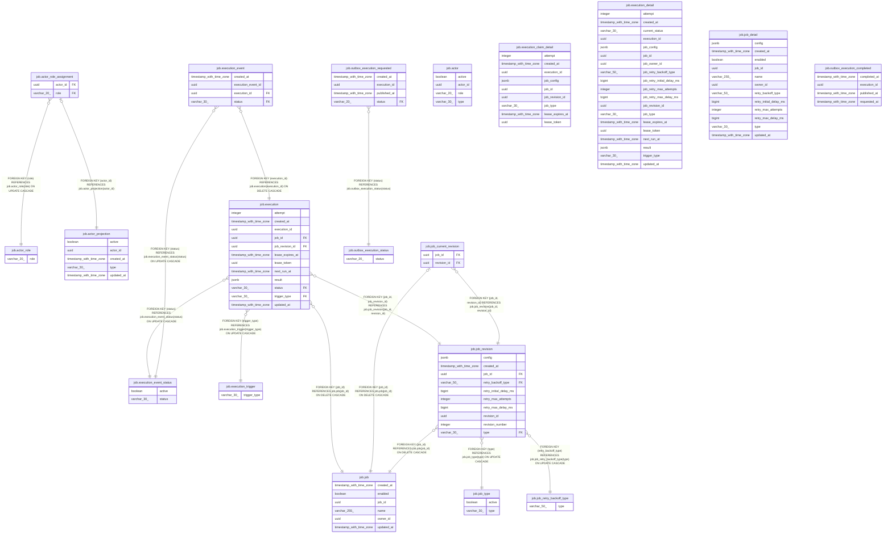

# jobdeck-job-api

## Tables

| Name | Columns | Comment | Type |
| ---- | ------- | ------- | ---- |
| [job.actor](job.actor.md) | 4 |  | VIEW |
| [job.actor_projection](job.actor_projection.md) | 5 |  | BASE TABLE |
| [job.actor_role](job.actor_role.md) | 1 |  | BASE TABLE |
| [job.actor_role_assignment](job.actor_role_assignment.md) | 2 |  | BASE TABLE |
| [job.execution](job.execution.md) | 12 |  | BASE TABLE |
| [job.execution_claim_detail](job.execution_claim_detail.md) | 9 |  | VIEW |
| [job.execution_detail](job.execution_detail.md) | 19 |  | VIEW |
| [job.execution_event](job.execution_event.md) | 4 |  | BASE TABLE |
| [job.execution_event_status](job.execution_event_status.md) | 2 |  | BASE TABLE |
| [job.execution_trigger](job.execution_trigger.md) | 1 |  | BASE TABLE |
| [job.job](job.job.md) | 6 |  | BASE TABLE |
| [job.job_current_revision](job.job_current_revision.md) | 2 |  | BASE TABLE |
| [job.job_detail](job.job_detail.md) | 12 |  | VIEW |
| [job.job_retry_backoff_type](job.job_retry_backoff_type.md) | 1 |  | BASE TABLE |
| [job.job_revision](job.job_revision.md) | 10 |  | BASE TABLE |
| [job.job_type](job.job_type.md) | 2 |  | BASE TABLE |
| [job.outbox_execution_completed](job.outbox_execution_completed.md) | 4 |  | BASE TABLE |
| [job.outbox_execution_requested](job.outbox_execution_requested.md) | 4 |  | BASE TABLE |
| [job.outbox_execution_status](job.outbox_execution_status.md) | 1 |  | BASE TABLE |

## Stored procedures and functions

| Name | ReturnType | Arguments | Type |
| ---- | ------- | ------- | ---- |
| job.update_updated_at_column | trigger |  | FUNCTION |

## Relations

---

> Generated by [tbls](https://github.com/k1LoW/tbls)
