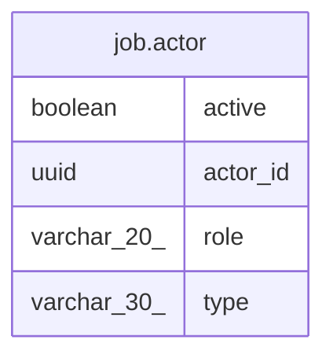

# job.actor

## Description

<details>
<summary><strong>Table Definition</strong></summary>

```sql
CREATE VIEW actor AS (
 SELECT ap.actor_id,
    ap.type,
    ap.active,
    ar.role
   FROM (job.actor_projection ap
     LEFT JOIN job.actor_role_assignment ar USING (actor_id))
)
```

</details>

## Columns

| Name | Type | Default | Nullable | Children | Parents | Comment |
| ---- | ---- | ------- | -------- | -------- | ------- | ------- |
| active | boolean |  | true |  |  |  |
| actor_id | uuid |  | true |  |  |  |
| role | varchar(20) |  | true |  |  |  |
| type | varchar(30) |  | true |  |  |  |

## Referenced Tables

| Name | Columns | Comment | Type |
| ---- | ------- | ------- | ---- |
| [job.actor_projection](job.actor_projection.md) | 5 |  | BASE TABLE |
| [job.actor_role_assignment](job.actor_role_assignment.md) | 2 |  | BASE TABLE |

## Relations



---

> Generated by [tbls](https://github.com/k1LoW/tbls)
