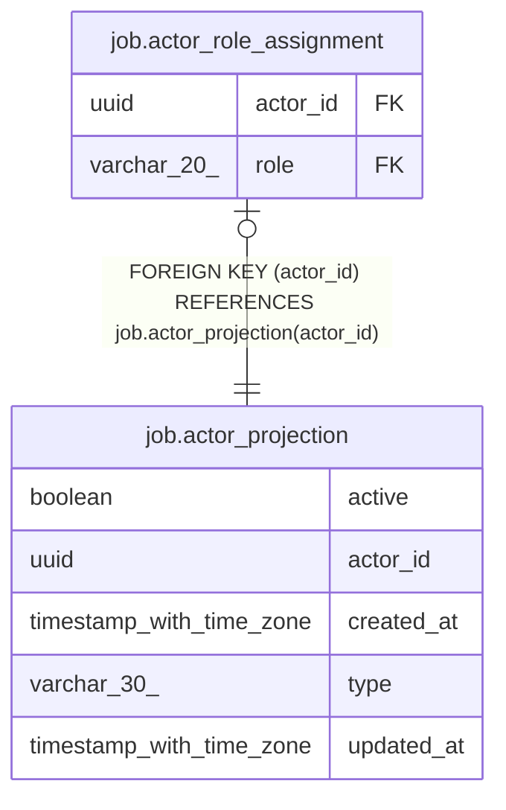

# job.actor_projection

## Columns

| Name | Type | Default | Nullable | Children | Parents | Comment |
| ---- | ---- | ------- | -------- | -------- | ------- | ------- |
| active | boolean | true | false |  |  |  |
| actor_id | uuid |  | false | [job.actor_role_assignment](job.actor_role_assignment.md) |  |  |
| created_at | timestamp with time zone | now() | false |  |  |  |
| type | varchar(30) |  | false |  |  |  |
| updated_at | timestamp with time zone | now() | false |  |  |  |

## Constraints

| Name | Type | Definition |
| ---- | ---- | ---------- |
| actor_projection_active_not_null | n | NOT NULL active |
| actor_projection_actor_id_not_null | n | NOT NULL actor_id |
| actor_projection_created_at_not_null | n | NOT NULL created_at |
| actor_projection_pkey | PRIMARY KEY | PRIMARY KEY (actor_id) |
| actor_projection_type_not_null | n | NOT NULL type |
| actor_projection_updated_at_not_null | n | NOT NULL updated_at |

## Indexes

| Name | Definition |
| ---- | ---------- |
| actor_projection_pkey | CREATE UNIQUE INDEX actor_projection_pkey ON job.actor_projection USING btree (actor_id) |

## Triggers

| Name | Definition |
| ---- | ---------- |
| actor_projection_updated_at | CREATE TRIGGER actor_projection_updated_at BEFORE UPDATE ON job.actor_projection FOR EACH ROW EXECUTE FUNCTION job.update_updated_at_column() |

## Relations

---

> Generated by [tbls](https://github.com/k1LoW/tbls)
