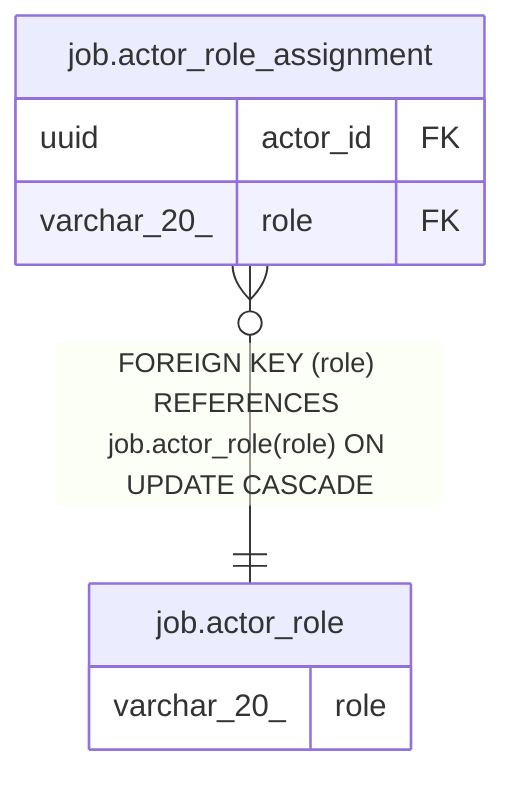

# job.actor_role

## Columns

| Name | Type | Default | Nullable | Children | Parents | Comment |
| ---- | ---- | ------- | -------- | -------- | ------- | ------- |
| role | varchar(20) |  | false | [job.actor_role_assignment](job.actor_role_assignment.md) |  |  |

## Constraints

| Name | Type | Definition |
| ---- | ---- | ---------- |
| actor_role_pkey | PRIMARY KEY | PRIMARY KEY (role) |
| actor_role_role_not_null | n | NOT NULL role |

## Indexes

| Name | Definition |
| ---- | ---------- |
| actor_role_pkey | CREATE UNIQUE INDEX actor_role_pkey ON job.actor_role USING btree (role) |

## Relations

---

> Generated by [tbls](https://github.com/k1LoW/tbls)
