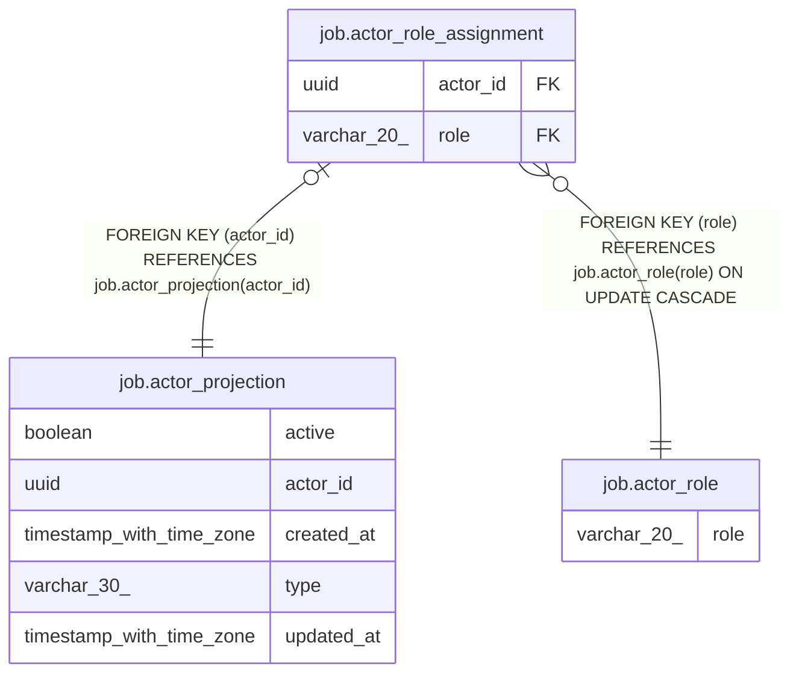

# job.actor_role_assignment

## Columns

| Name | Type | Default | Nullable | Children | Parents | Comment |
| ---- | ---- | ------- | -------- | -------- | ------- | ------- |
| actor_id | uuid |  | false |  | [job.actor_projection](job.actor_projection.md) |  |
| role | varchar(20) |  | false |  | [job.actor_role](job.actor_role.md) |  |

## Constraints

| Name | Type | Definition |
| ---- | ---- | ---------- |
| actor_role_assignment_actor_id_not_null | n | NOT NULL actor_id |
| actor_role_assignment_pkey | PRIMARY KEY | PRIMARY KEY (actor_id) |
| actor_role_assignment_role_not_null | n | NOT NULL role |
| fk_actor_id | FOREIGN KEY | FOREIGN KEY (actor_id) REFERENCES job.actor_projection(actor_id) |
| fk_role | FOREIGN KEY | FOREIGN KEY (role) REFERENCES job.actor_role(role) ON UPDATE CASCADE |

## Indexes

| Name | Definition |
| ---- | ---------- |
| actor_role_assignment_pkey | CREATE UNIQUE INDEX actor_role_assignment_pkey ON job.actor_role_assignment USING btree (actor_id) |

## Relations

---

> Generated by [tbls](https://github.com/k1LoW/tbls)
