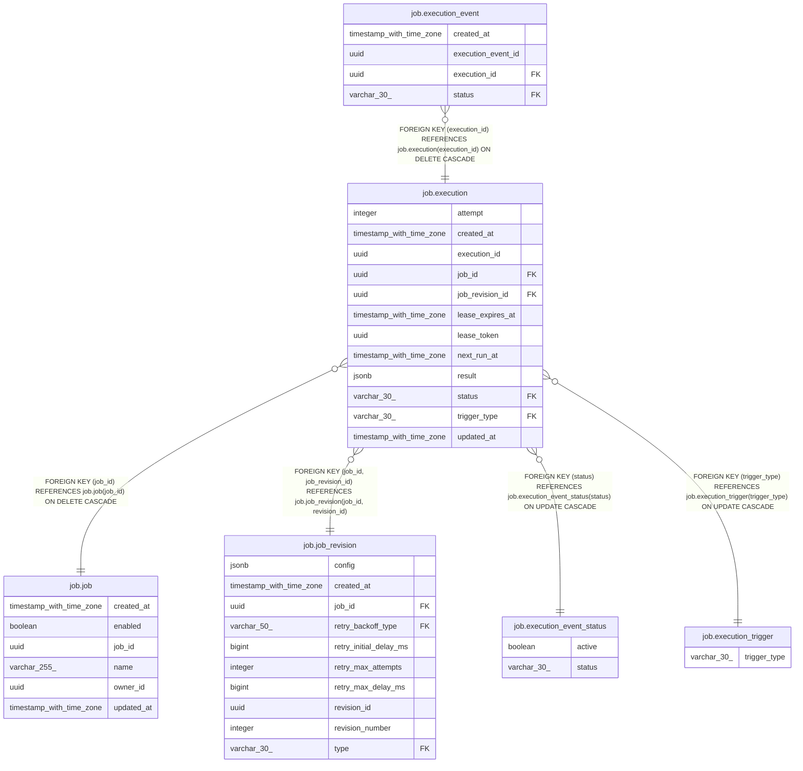

# job.execution

## Columns

| Name | Type | Default | Nullable | Children | Parents | Comment |
| ---- | ---- | ------- | -------- | -------- | ------- | ------- |
| attempt | integer | 0 | false |  |  |  |
| created_at | timestamp with time zone | now() | false |  |  |  |
| execution_id | uuid | uuidv7() | false | [job.execution_event](job.execution_event.md) |  |  |
| job_id | uuid |  | false |  | [job.job](job.job.md) [job.job_revision](job.job_revision.md) |  |
| job_revision_id | uuid |  | false |  | [job.job_revision](job.job_revision.md) |  |
| lease_expires_at | timestamp with time zone |  | true |  |  |  |
| lease_token | uuid |  | true |  |  |  |
| next_run_at | timestamp with time zone | now() | false |  |  |  |
| result | jsonb |  | true |  |  |  |
| status | varchar(30) |  | false |  | [job.execution_event_status](job.execution_event_status.md) |  |
| trigger_type | varchar(30) |  | false |  | [job.execution_trigger](job.execution_trigger.md) |  |
| updated_at | timestamp with time zone | now() | false |  |  |  |

## Constraints

| Name | Type | Definition |
| ---- | ---- | ---------- |
| execution_attempt_not_null | n | NOT NULL attempt |
| execution_created_at_not_null | n | NOT NULL created_at |
| execution_execution_id_not_null | n | NOT NULL execution_id |
| execution_job_id_fkey | FOREIGN KEY | FOREIGN KEY (job_id) REFERENCES job.job(job_id) ON DELETE CASCADE |
| execution_job_id_not_null | n | NOT NULL job_id |
| execution_job_revision_id_not_null | n | NOT NULL job_revision_id |
| execution_next_run_at_not_null | n | NOT NULL next_run_at |
| execution_pkey | PRIMARY KEY | PRIMARY KEY (execution_id) |
| execution_status_fkey | FOREIGN KEY | FOREIGN KEY (status) REFERENCES job.execution_event_status(status) ON UPDATE CASCADE |
| execution_status_not_null | n | NOT NULL status |
| execution_trigger_type_fkey | FOREIGN KEY | FOREIGN KEY (trigger_type) REFERENCES job.execution_trigger(trigger_type) ON UPDATE CASCADE |
| execution_trigger_type_not_null | n | NOT NULL trigger_type |
| execution_updated_at_not_null | n | NOT NULL updated_at |
| fk_job_id_rev_id | FOREIGN KEY | FOREIGN KEY (job_id, job_revision_id) REFERENCES job.job_revision(job_id, revision_id) |

## Indexes

| Name | Definition |
| ---- | ---------- |
| execution_pkey | CREATE UNIQUE INDEX execution_pkey ON job.execution USING btree (execution_id) |
| execution_status_next_run_at_idx | CREATE INDEX execution_status_next_run_at_idx ON job.execution USING btree (status, next_run_at) |
| job_id_idx | CREATE INDEX job_id_idx ON job.execution USING btree (job_id) |

## Triggers

| Name | Definition |
| ---- | ---------- |
| execution_updated_at | CREATE TRIGGER execution_updated_at BEFORE UPDATE ON job.execution FOR EACH ROW EXECUTE FUNCTION job.update_updated_at_column() |

## Relations

---

> Generated by [tbls](https://github.com/k1LoW/tbls)
