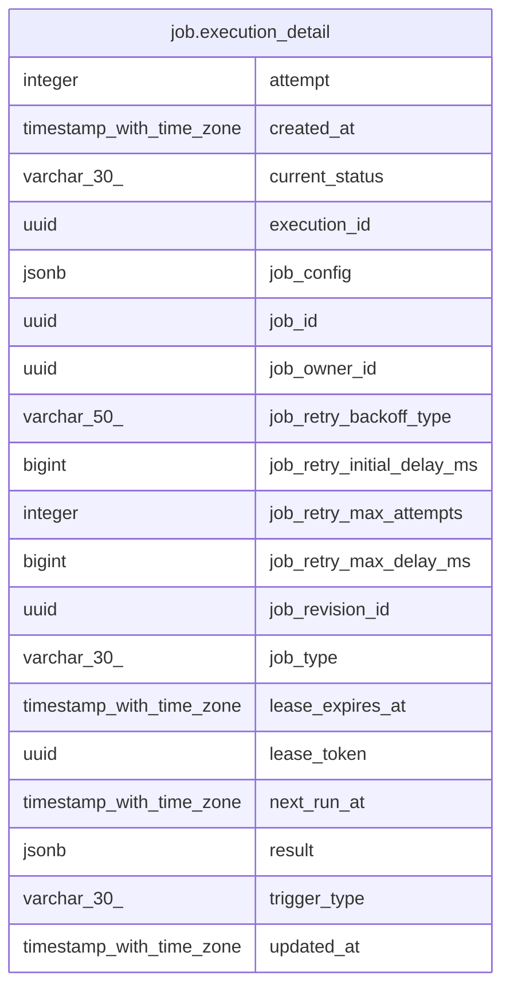

# job.execution_detail

## Description

<details>
<summary><strong>Table Definition</strong></summary>

```sql
CREATE VIEW execution_detail AS (
 SELECT e.execution_id,
    e.job_id,
    j.owner_id AS job_owner_id,
    e.job_revision_id,
    e.trigger_type,
    e.status AS current_status,
    e.attempt,
    e.lease_token,
    e.lease_expires_at,
    e.next_run_at,
    e.result,
    e.created_at,
    e.updated_at,
    r.type AS job_type,
    r.config AS job_config,
    r.retry_max_attempts AS job_retry_max_attempts,
    r.retry_backoff_type AS job_retry_backoff_type,
    r.retry_initial_delay_ms AS job_retry_initial_delay_ms,
    r.retry_max_delay_ms AS job_retry_max_delay_ms
   FROM ((job.execution e
     JOIN job.job_revision r ON (((e.job_id = r.job_id) AND (e.job_revision_id = r.revision_id))))
     JOIN job.job j ON ((e.job_id = j.job_id)))
)
```

</details>

## Columns

| Name | Type | Default | Nullable | Children | Parents | Comment |
| ---- | ---- | ------- | -------- | -------- | ------- | ------- |
| attempt | integer |  | true |  |  |  |
| created_at | timestamp with time zone |  | true |  |  |  |
| current_status | varchar(30) |  | true |  |  |  |
| execution_id | uuid |  | true |  |  |  |
| job_config | jsonb |  | true |  |  |  |
| job_id | uuid |  | true |  |  |  |
| job_owner_id | uuid |  | true |  |  |  |
| job_retry_backoff_type | varchar(50) |  | true |  |  |  |
| job_retry_initial_delay_ms | bigint |  | true |  |  |  |
| job_retry_max_attempts | integer |  | true |  |  |  |
| job_retry_max_delay_ms | bigint |  | true |  |  |  |
| job_revision_id | uuid |  | true |  |  |  |
| job_type | varchar(30) |  | true |  |  |  |
| lease_expires_at | timestamp with time zone |  | true |  |  |  |
| lease_token | uuid |  | true |  |  |  |
| next_run_at | timestamp with time zone |  | true |  |  |  |
| result | jsonb |  | true |  |  |  |
| trigger_type | varchar(30) |  | true |  |  |  |
| updated_at | timestamp with time zone |  | true |  |  |  |

## Referenced Tables

| Name | Columns | Comment | Type |
| ---- | ------- | ------- | ---- |
| [job.execution](job.execution.md) | 12 |  | BASE TABLE |
| [job.job_revision](job.job_revision.md) | 10 |  | BASE TABLE |
| [job.job](job.job.md) | 6 |  | BASE TABLE |

## Relations



---

> Generated by [tbls](https://github.com/k1LoW/tbls)
