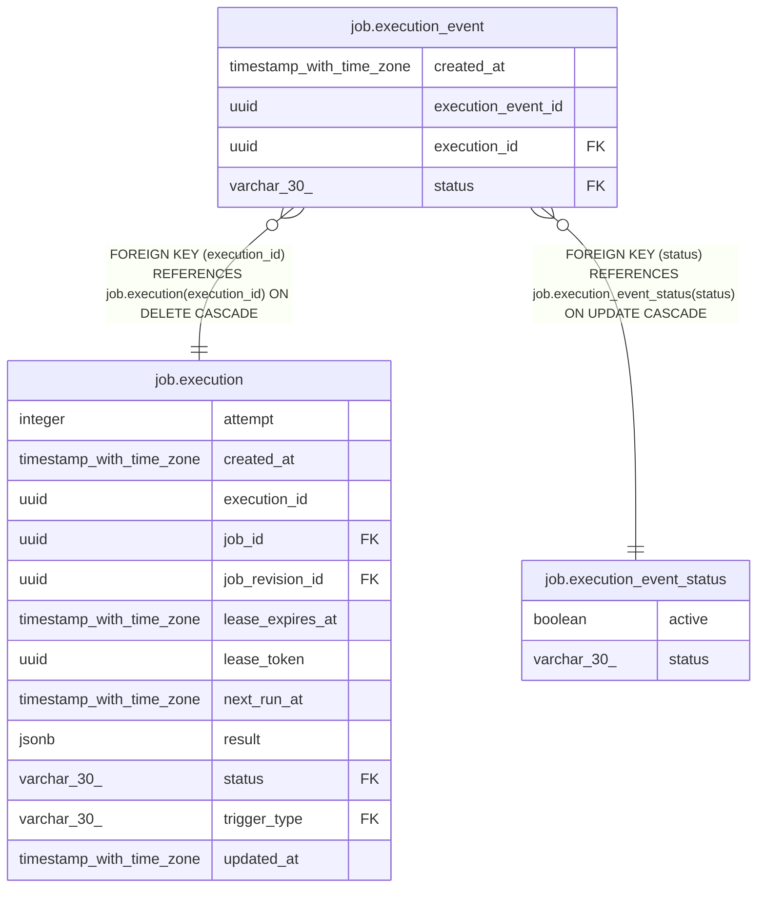

# job.execution_event

## Columns

| Name | Type | Default | Nullable | Children | Parents | Comment |
| ---- | ---- | ------- | -------- | -------- | ------- | ------- |
| created_at | timestamp with time zone | now() | false |  |  |  |
| execution_event_id | uuid | uuidv7() | false |  |  |  |
| execution_id | uuid |  | false |  | [job.execution](job.execution.md) |  |
| status | varchar(30) |  | false |  | [job.execution_event_status](job.execution_event_status.md) |  |

## Constraints

| Name | Type | Definition |
| ---- | ---- | ---------- |
| execution_event_created_at_not_null | n | NOT NULL created_at |
| execution_event_execution_event_id_not_null | n | NOT NULL execution_event_id |
| execution_event_execution_id_fkey | FOREIGN KEY | FOREIGN KEY (execution_id) REFERENCES job.execution(execution_id) ON DELETE CASCADE |
| execution_event_execution_id_not_null | n | NOT NULL execution_id |
| execution_event_pkey | PRIMARY KEY | PRIMARY KEY (execution_event_id) |
| execution_event_status_fkey | FOREIGN KEY | FOREIGN KEY (status) REFERENCES job.execution_event_status(status) ON UPDATE CASCADE |
| execution_event_status_not_null | n | NOT NULL status |

## Indexes

| Name | Definition |
| ---- | ---------- |
| execution_event_execution_id_idx | CREATE INDEX execution_event_execution_id_idx ON job.execution_event USING btree (execution_id) |
| execution_event_pkey | CREATE UNIQUE INDEX execution_event_pkey ON job.execution_event USING btree (execution_event_id) |
| execution_event_status_idx | CREATE INDEX execution_event_status_idx ON job.execution_event USING btree (status) |

## Relations

---

> Generated by [tbls](https://github.com/k1LoW/tbls)
