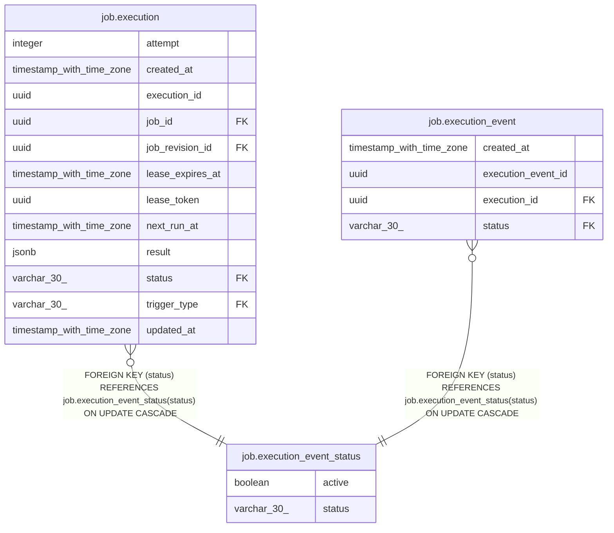

# job.execution_event_status

## Columns

| Name | Type | Default | Nullable | Children | Parents | Comment |
| ---- | ---- | ------- | -------- | -------- | ------- | ------- |
| active | boolean | true | false |  |  |  |
| status | varchar(30) |  | false | [job.execution](job.execution.md) [job.execution_event](job.execution_event.md) |  |  |

## Constraints

| Name | Type | Definition |
| ---- | ---- | ---------- |
| execution_event_status_active_not_null | n | NOT NULL active |
| execution_event_status_pkey | PRIMARY KEY | PRIMARY KEY (status) |
| execution_event_status_status_not_null | n | NOT NULL status |

## Indexes

| Name | Definition |
| ---- | ---------- |
| execution_event_status_pkey | CREATE UNIQUE INDEX execution_event_status_pkey ON job.execution_event_status USING btree (status) |

## Relations

---

> Generated by [tbls](https://github.com/k1LoW/tbls)
