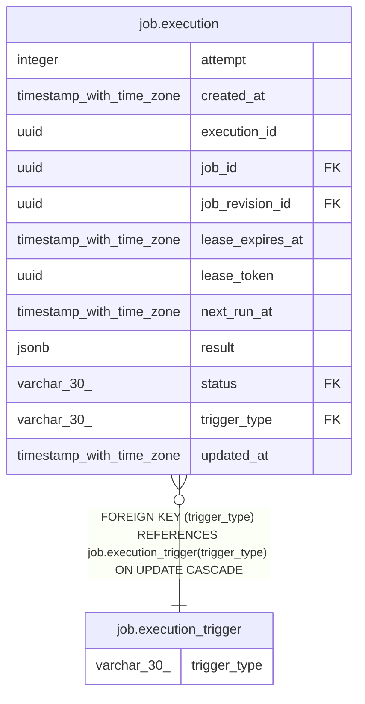

# job.execution_trigger

## Columns

| Name | Type | Default | Nullable | Children | Parents | Comment |
| ---- | ---- | ------- | -------- | -------- | ------- | ------- |
| trigger_type | varchar(30) |  | false | [job.execution](job.execution.md) |  |  |

## Constraints

| Name | Type | Definition |
| ---- | ---- | ---------- |
| execution_trigger_pkey | PRIMARY KEY | PRIMARY KEY (trigger_type) |
| execution_trigger_trigger_type_not_null | n | NOT NULL trigger_type |

## Indexes

| Name | Definition |
| ---- | ---------- |
| execution_trigger_pkey | CREATE UNIQUE INDEX execution_trigger_pkey ON job.execution_trigger USING btree (trigger_type) |

## Relations

---

> Generated by [tbls](https://github.com/k1LoW/tbls)
