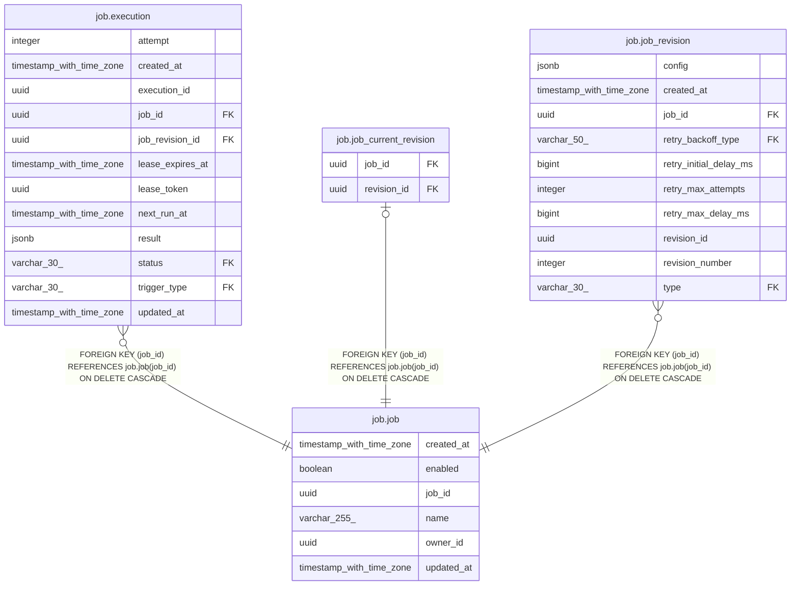

# job.job

## Columns

| Name | Type | Default | Nullable | Children | Parents | Comment |
| ---- | ---- | ------- | -------- | -------- | ------- | ------- |
| created_at | timestamp with time zone | now() | false |  |  |  |
| enabled | boolean | true | false |  |  |  |
| job_id | uuid | uuidv7() | false | [job.execution](job.execution.md) [job.job_current_revision](job.job_current_revision.md) [job.job_revision](job.job_revision.md) |  |  |
| name | varchar(255) |  | false |  |  |  |
| owner_id | uuid |  | false |  |  |  |
| updated_at | timestamp with time zone | now() | false |  |  |  |

## Constraints

| Name | Type | Definition |
| ---- | ---- | ---------- |
| job_created_at_not_null | n | NOT NULL created_at |
| job_enabled_not_null | n | NOT NULL enabled |
| job_job_id_not_null | n | NOT NULL job_id |
| job_name_not_null | n | NOT NULL name |
| job_owner_id_not_null | n | NOT NULL owner_id |
| job_pkey | PRIMARY KEY | PRIMARY KEY (job_id) |
| job_updated_at_not_null | n | NOT NULL updated_at |

## Indexes

| Name | Definition |
| ---- | ---------- |
| job_created_at_job_id | CREATE INDEX job_created_at_job_id ON job.job USING btree (created_at, job_id) |
| job_owner_id_idx | CREATE INDEX job_owner_id_idx ON job.job USING btree (owner_id) |
| job_pkey | CREATE UNIQUE INDEX job_pkey ON job.job USING btree (job_id) |

## Triggers

| Name | Definition |
| ---- | ---------- |
| job_updated_at | CREATE TRIGGER job_updated_at BEFORE UPDATE ON job.job FOR EACH ROW EXECUTE FUNCTION job.update_updated_at_column() |

## Relations

---

> Generated by [tbls](https://github.com/k1LoW/tbls)
