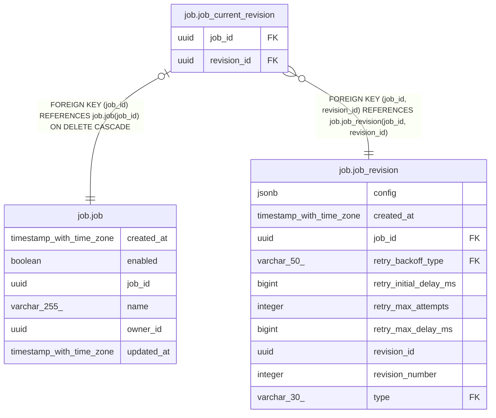

# job.job_current_revision

## Columns

| Name | Type | Default | Nullable | Children | Parents | Comment |
| ---- | ---- | ------- | -------- | -------- | ------- | ------- |
| job_id | uuid |  | false |  | [job.job](job.job.md) [job.job_revision](job.job_revision.md) |  |
| revision_id | uuid |  | false |  | [job.job_revision](job.job_revision.md) |  |

## Constraints

| Name | Type | Definition |
| ---- | ---- | ---------- |
| fk_job_id | FOREIGN KEY | FOREIGN KEY (job_id) REFERENCES job.job(job_id) ON DELETE CASCADE |
| fk_job_id_rev_id | FOREIGN KEY | FOREIGN KEY (job_id, revision_id) REFERENCES job.job_revision(job_id, revision_id) |
| job_current_revision_job_id_not_null | n | NOT NULL job_id |
| job_current_revision_pkey | PRIMARY KEY | PRIMARY KEY (job_id) |
| job_current_revision_revision_id_not_null | n | NOT NULL revision_id |
| uq_rev_id | UNIQUE | UNIQUE (revision_id) |

## Indexes

| Name | Definition |
| ---- | ---------- |
| job_current_revision_pkey | CREATE UNIQUE INDEX job_current_revision_pkey ON job.job_current_revision USING btree (job_id) |
| uq_rev_id | CREATE UNIQUE INDEX uq_rev_id ON job.job_current_revision USING btree (revision_id) |

## Relations

---

> Generated by [tbls](https://github.com/k1LoW/tbls)
