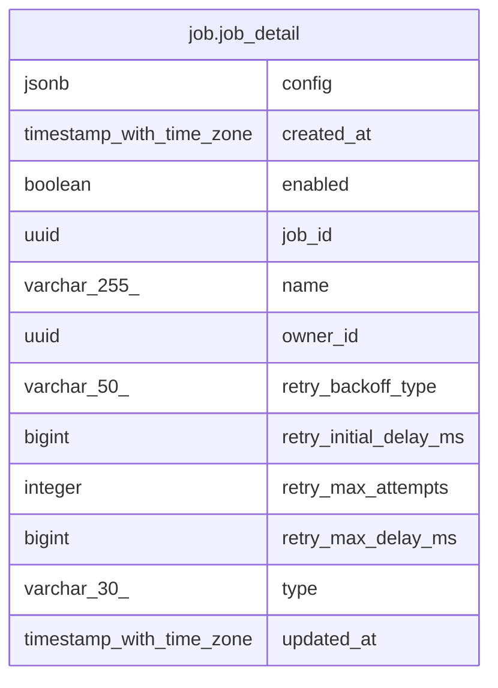

# job.job_detail

## Description

<details>
<summary><strong>Table Definition</strong></summary>

```sql
CREATE VIEW job_detail AS (
 SELECT j.job_id,
    j.owner_id,
    j.enabled,
    j.name,
    j.created_at,
    j.updated_at,
    r.type,
    r.config,
    r.retry_max_attempts,
    r.retry_backoff_type,
    r.retry_initial_delay_ms,
    r.retry_max_delay_ms
   FROM ((job.job j
     JOIN job.job_current_revision cr ON ((j.job_id = cr.job_id)))
     JOIN job.job_revision r ON (((cr.job_id = r.job_id) AND (cr.revision_id = r.revision_id))))
)
```

</details>

## Columns

| Name | Type | Default | Nullable | Children | Parents | Comment |
| ---- | ---- | ------- | -------- | -------- | ------- | ------- |
| config | jsonb |  | true |  |  |  |
| created_at | timestamp with time zone |  | true |  |  |  |
| enabled | boolean |  | true |  |  |  |
| job_id | uuid |  | true |  |  |  |
| name | varchar(255) |  | true |  |  |  |
| owner_id | uuid |  | true |  |  |  |
| retry_backoff_type | varchar(50) |  | true |  |  |  |
| retry_initial_delay_ms | bigint |  | true |  |  |  |
| retry_max_attempts | integer |  | true |  |  |  |
| retry_max_delay_ms | bigint |  | true |  |  |  |
| type | varchar(30) |  | true |  |  |  |
| updated_at | timestamp with time zone |  | true |  |  |  |

## Referenced Tables

| Name | Columns | Comment | Type |
| ---- | ------- | ------- | ---- |
| [job.job](job.job.md) | 6 |  | BASE TABLE |
| [job.job_current_revision](job.job_current_revision.md) | 2 |  | BASE TABLE |
| [job.job_revision](job.job_revision.md) | 10 |  | BASE TABLE |

## Relations



---

> Generated by [tbls](https://github.com/k1LoW/tbls)
