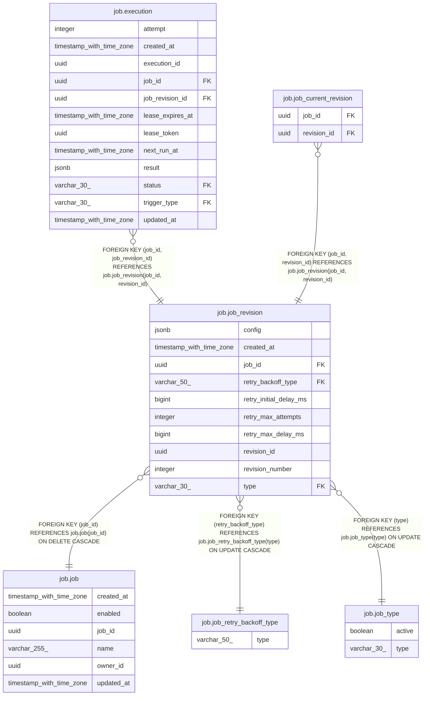

# job.job_revision

## Columns

| Name | Type | Default | Nullable | Children | Parents | Comment |
| ---- | ---- | ------- | -------- | -------- | ------- | ------- |
| config | jsonb |  | false |  |  |  |
| created_at | timestamp with time zone | now() | false |  |  |  |
| job_id | uuid |  | false | [job.execution](job.execution.md) [job.job_current_revision](job.job_current_revision.md) | [job.job](job.job.md) |  |
| retry_backoff_type | varchar(50) |  | false |  | [job.job_retry_backoff_type](job.job_retry_backoff_type.md) |  |
| retry_initial_delay_ms | bigint | 0 | false |  |  |  |
| retry_max_attempts | integer | 1 | false |  |  |  |
| retry_max_delay_ms | bigint |  | false |  |  |  |
| revision_id | uuid | uuidv7() | false | [job.execution](job.execution.md) [job.job_current_revision](job.job_current_revision.md) |  |  |
| revision_number | integer |  | false |  |  |  |
| type | varchar(30) |  | false |  | [job.job_type](job.job_type.md) |  |

## Constraints

| Name | Type | Definition |
| ---- | ---- | ---------- |
| fk_job_id | FOREIGN KEY | FOREIGN KEY (job_id) REFERENCES job.job(job_id) ON DELETE CASCADE |
| fk_job_retry_backoff_type | FOREIGN KEY | FOREIGN KEY (retry_backoff_type) REFERENCES job.job_retry_backoff_type(type) ON UPDATE CASCADE |
| fk_job_type | FOREIGN KEY | FOREIGN KEY (type) REFERENCES job.job_type(type) ON UPDATE CASCADE |
| job_revision_config_not_null | n | NOT NULL config |
| job_revision_created_at_not_null | n | NOT NULL created_at |
| job_revision_job_id_not_null | n | NOT NULL job_id |
| job_revision_pkey | PRIMARY KEY | PRIMARY KEY (revision_id) |
| job_revision_retry_backoff_type_not_null | n | NOT NULL retry_backoff_type |
| job_revision_retry_initial_delay_ms_not_null | n | NOT NULL retry_initial_delay_ms |
| job_revision_retry_max_attempts_not_null | n | NOT NULL retry_max_attempts |
| job_revision_retry_max_delay_ms_not_null | n | NOT NULL retry_max_delay_ms |
| job_revision_revision_id_not_null | n | NOT NULL revision_id |
| job_revision_revision_number_not_null | n | NOT NULL revision_number |
| job_revision_type_not_null | n | NOT NULL type |
| uq_job_id_rev_id | UNIQUE | UNIQUE (job_id, revision_id) |
| uq_job_id_rev_number | UNIQUE | UNIQUE (job_id, revision_number) |

## Indexes

| Name | Definition |
| ---- | ---------- |
| job_revision_job_id_created_at_idx | CREATE INDEX job_revision_job_id_created_at_idx ON job.job_revision USING btree (job_id, created_at DESC) |
| job_revision_pkey | CREATE UNIQUE INDEX job_revision_pkey ON job.job_revision USING btree (revision_id) |
| uq_job_id_rev_id | CREATE UNIQUE INDEX uq_job_id_rev_id ON job.job_revision USING btree (job_id, revision_id) |
| uq_job_id_rev_number | CREATE UNIQUE INDEX uq_job_id_rev_number ON job.job_revision USING btree (job_id, revision_number) |

## Relations

---

> Generated by [tbls](https://github.com/k1LoW/tbls)
