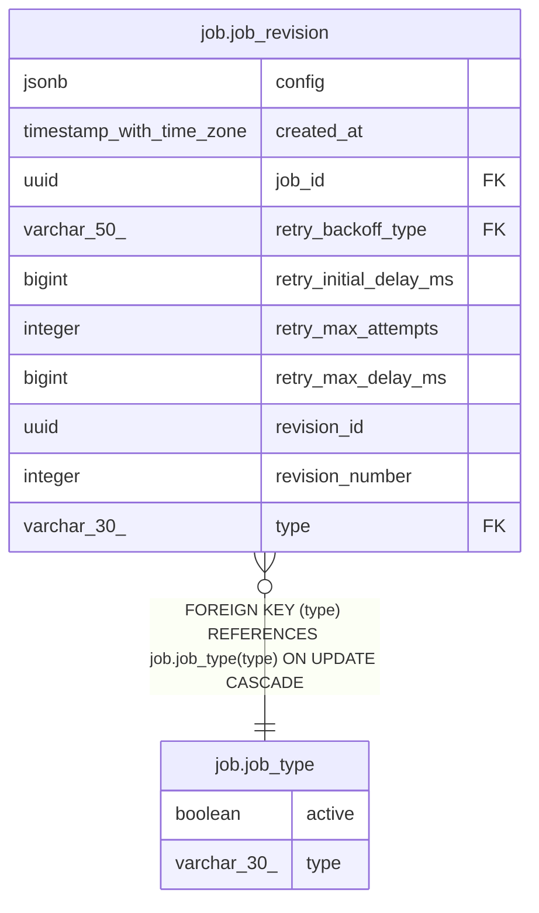

# job.job_type

## Columns

| Name | Type | Default | Nullable | Children | Parents | Comment |
| ---- | ---- | ------- | -------- | -------- | ------- | ------- |
| active | boolean | true | false |  |  |  |
| type | varchar(30) |  | false | [job.job_revision](job.job_revision.md) |  |  |

## Constraints

| Name | Type | Definition |
| ---- | ---- | ---------- |
| job_type_active_not_null | n | NOT NULL active |
| job_type_pkey | PRIMARY KEY | PRIMARY KEY (type) |
| job_type_type_not_null | n | NOT NULL type |

## Indexes

| Name | Definition |
| ---- | ---------- |
| job_type_pkey | CREATE UNIQUE INDEX job_type_pkey ON job.job_type USING btree (type) |

## Relations

---

> Generated by [tbls](https://github.com/k1LoW/tbls)
