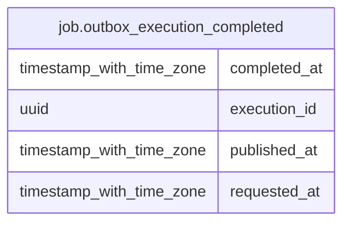

# job.outbox_execution_completed

## Columns

| Name | Type | Default | Nullable | Children | Parents | Comment |
| ---- | ---- | ------- | -------- | -------- | ------- | ------- |
| completed_at | timestamp with time zone | now() | false |  |  |  |
| execution_id | uuid |  | false |  |  |  |
| published_at | timestamp with time zone |  | false |  |  |  |
| requested_at | timestamp with time zone |  | false |  |  |  |

## Constraints

| Name | Type | Definition |
| ---- | ---- | ---------- |
| outbox_execution_completed_completed_at_not_null | n | NOT NULL completed_at |
| outbox_execution_completed_execution_id_not_null | n | NOT NULL execution_id |
| outbox_execution_completed_pkey | PRIMARY KEY | PRIMARY KEY (execution_id) |
| outbox_execution_completed_published_at_not_null | n | NOT NULL published_at |
| outbox_execution_completed_requested_at_not_null | n | NOT NULL requested_at |

## Indexes

| Name | Definition |
| ---- | ---------- |
| outbox_execution_completed_pkey | CREATE UNIQUE INDEX outbox_execution_completed_pkey ON job.outbox_execution_completed USING btree (execution_id) |

## Relations

---

> Generated by [tbls](https://github.com/k1LoW/tbls)
