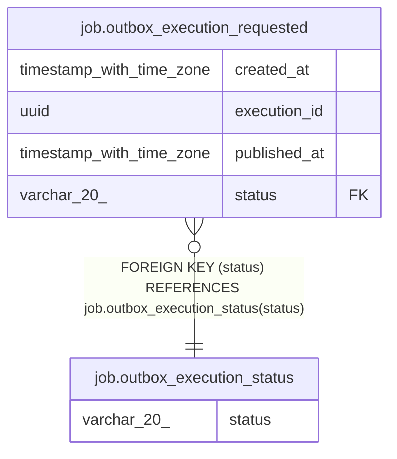

# job.outbox_execution_requested

## Columns

| Name | Type | Default | Nullable | Children | Parents | Comment |
| ---- | ---- | ------- | -------- | -------- | ------- | ------- |
| created_at | timestamp with time zone | now() | false |  |  |  |
| execution_id | uuid |  | false |  |  |  |
| published_at | timestamp with time zone |  | true |  |  |  |
| status | varchar(20) | 'REQUESTED'::character varying | false |  | [job.outbox_execution_status](job.outbox_execution_status.md) |  |

## Constraints

| Name | Type | Definition |
| ---- | ---- | ---------- |
| fk_status | FOREIGN KEY | FOREIGN KEY (status) REFERENCES job.outbox_execution_status(status) |
| outbox_execution_requested_created_at_not_null | n | NOT NULL created_at |
| outbox_execution_requested_execution_id_not_null | n | NOT NULL execution_id |
| outbox_execution_requested_pkey | PRIMARY KEY | PRIMARY KEY (execution_id) |
| outbox_execution_requested_status_not_null | n | NOT NULL status |

## Indexes

| Name | Definition |
| ---- | ---------- |
| outbox_execution_requested_pkey | CREATE UNIQUE INDEX outbox_execution_requested_pkey ON job.outbox_execution_requested USING btree (execution_id) |
| outbox_execution_requested_status_created_at | CREATE INDEX outbox_execution_requested_status_created_at ON job.outbox_execution_requested USING btree (status, created_at) |

## Relations

---

> Generated by [tbls](https://github.com/k1LoW/tbls)
